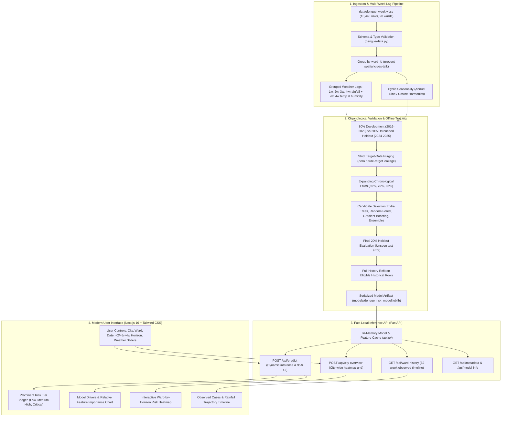

# WardWatch Architecture & Technical Design

## Intent & Overview

WardWatch is a reproducible, local dengue early-warning and epidemiological risk-forecasting system for public health planners in Bangladesh. It ingests weekly municipal weather observations and case histories, constructs ward-grouped multi-week lag features, performs nested chronological model selection, and serves sub-10ms inference through a modern **Next.js** web dashboard backed by a high-performance **FastAPI** prediction engine (with backward-compatible support for the original Streamlit interface).

---

## 1. End-to-End System Data Flow



---

## 2. Multi-Week Weather Lag Pipeline

Mosquito breeding biology (*Aedes aegypti*) indicates that eggs hatch and mature into adult biting vectors approximately 7 to 10 days after rainfall events, with peak transmission manifesting 2 to 4 weeks later. 

`dengue/data.py` constructs a programmatic lag pipeline:
- **Grouped by `ward_id`**: All rolling windows, lags, and forward target shifts are strictly partitioned by municipal ward. A ward's rainfall or case history never crosses into another neighborhood.
- **Multi-Week Precipitation Lags**:
  - `rainfall_1w_mm`: Immediate 1-week rainfall (acute short-term breeding trigger).
  - `rainfall_2w_mm`: Rolling 2-week sum.
  - `rainfall_3w_mm`: Rolling 3-week sum.
  - `rainfall_4w_mm`: Rolling 4-week cumulative rainfall.
- **Thermal & Moisture Averages**:
  - `avg_temp_2w_c` and `avg_temp_4w_c`: 2-week and 4-week rolling mean temperatures.
  - `relative_humidity_2w_pct` and `relative_humidity_4w_pct`: Rolling mean humidity.
- **Epidemiological Memory**:
  - `dengue_cases_4w`: Cumulative reported cases over the preceding 4 weeks.
- **Cyclic Annual Seasonality**:
  - `week_sin` and `week_cos`: Periodic harmonic encoding of day-of-year ($T = 365.25$ days).
- **Static Ward Vulnerabilities**:
  - `population_density_sqkm`, `water_logging_risk_index`, `sanitation_score`.

---

## 3. Justification for Chronological Validation Split

Standard random k-fold cross-validation is fundamentally invalid for time-series forecasting because it randomly samples past and future points, leaking future outbreak trajectories into training sets and resulting in falsely optimistic error metrics.

WardWatch enforces strict **Nested Chronological Validation**:
1. **Quarantined Final Holdout (Untouched 20%)**:
   - Dates from **2024-01-01 through 2025-12-29** (105 weeks, 2,020 to 2,060 ward-week rows per horizon) were completely isolated.
   - This period was **never** used for feature selection, hyperparameter tuning, or candidate choice.
2. **Expanding Inner Development Folds**:
   - The first 80% of dates (2016-01-04 through 2023-12-25) forms the development window.
   - Candidate models are scored across 3 expanding chronological windows (`INNER_FOLD_FRACTIONS = (0.55, 0.70, 0.85)`).
3. **Strict Target-Date Purging**:
   - In time-series regression with a forward horizon $h \in \{2, 3, 4\}$, row $t$ predicts target $t + h$.
   - Any row whose target date crosses the validation start date ($t + h \ge \text{validation\_start}$) is purged from the training set.
   - This ensures zero overlap between the training target window and validation observations.

---

## 4. Model Selection Rationale

For each forecast horizon, multiple CPU-friendly, deterministic model architectures were evaluated on expanding validation RMSE:

1. **Random Forest**: Robust against noise, but tends to over-smooth acute peak outbreak counts.
2. **Extra Trees (Extremely Randomized Trees)**: Introduces random cut-point thresholds that reduce variance on right-skewed count data without increasing bias.
3. **Gradient Boosting Regressors**: Iteratively minimizes residual errors, capturing non-linear interactions between heavy rainfall and high water-logging vulnerability.
4. **Voting Ensembles (`FeatureImportanceVotingRegressor`)**: Blends Extra Trees with Gradient Boosting, combining low-variance tree bagging with iterative gradient optimization, while delegating normalized `feature_importances_` to explain predictions.

### Selection & Holdout Results

| Horizon | Winning Candidate | Validation RMSE | Final Holdout MAE | Final Holdout RMSE |
|:---:|---|:---:|:---:|:---:|
| **+2 weeks** | `voting_et_gb` (Extra Trees + Gradient Boosting) | **2.43** | 1.13 | 2.20 |
| **+3 weeks** | `extra_trees_tuned_deep` (300 trees, depth 11, leaf 3) | **2.32** | **1.09** | **2.09** |
| **+4 weeks** | `extra_trees_regularized` (256 trees, depth 10, leaf 4) | **2.74** | **1.24** | **2.35** |

*All metrics reported in cases per ward-week. After selection, winning models were refit on all eligible historical dates and serialized to `models/dengue_risk_model.joblib`.*

---

## 5. Compute & API Cost Efficiency Controls

| Control | Implementation Detail | Technical Benefit |
|---|---|---|
| **Zero External Paid APIs** | 100% self-contained local models; no Google Maps, OpenAI, or weather API calls. | **$0.00 cost**, zero network downtime, zero token consumption. |
| **Serialized Model Bundle** | Joblib artifact (`models/dengue_risk_model.joblib`, zlib level 3). | Instant cold-start (< 1 second) and fast portability. |
| **In-Memory Startup Cache** | FastAPI `lifespan` handler pre-computes feature frames and caches models in memory (`ModelStore`). | **Sub-10ms API inference**; zero disk I/O on inference requests. |
| **No Dynamic Retraining** | Weather scenario adjustments recompute model inference on the pre-fitted estimator. | Instant slider responsiveness without CPU exhaustion. |
| **Deterministic Seeds** | `random_state=42` pinned across all estimators and folds. | 100% reproducible results across runs. |

---

## 6. Directory Layout & Key Components

```
├── ARCHITECTURE.md              # System design and chronological validation rationale
├── README.md                    # Setup guide, copy-pasteable commands, disclosure
├── requirements.txt             # Python backend dependencies (FastAPI, scikit-learn, etc.)
├── api.py                       # FastAPI REST API serving model inference and history
├── app.py                       # Streamlit fallback dashboard
├── data/
│   └── dengue_weekly.csv        # Bundled source dataset (10,440 ward-week rows)
├── dengue/
│   ├── data.py                  # Ingestion, validation, and multi-week lag feature pipeline
│   └── model.py                 # Candidate models, chronological validation, serialization
├── frontend/                    # Next.js 16 modern App Router web dashboard
│   ├── app/
│   │   ├── globals.css          # Tailwind CSS styling and theme
│   │   ├── layout.tsx           # Dashboard layout shell and metadata
│   │   └── page.tsx             # Interactive dashboard (heatmap, sliders, drivers, CI)
│   ├── package.json             # Next.js dependencies
│   └── tsconfig.json            # TypeScript configuration
├── models/
│   └── dengue_risk_model.joblib # Serialized trained models & metadata bundle
├── scripts/
│   └── train_model.py           # Reproducible training and validation execution script
└── tests/
    └── test_forecast_pipeline.py# Unit tests for data isolation, leakage, and inference
```
