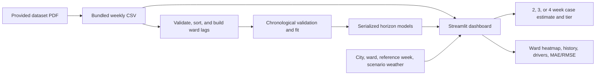

# WardWatch Dengue Early Warning

## Intent

Build a reproducible, local dashboard that helps public health teams compare ward-level dengue risk two to four weeks ahead. It turns the supplied weekly weather and case history into lagged features, fits a small local model, and shows risk tiers with the weather and vulnerability signals behind them.

## Goals

- Ingest and validate the supplied weekly dataset.
- Compute rolling two-week and four-week weather features by ward, plus static ward vulnerability and recent case history.
- Train separate models for weekly case counts at weeks 2, 3, and 4 after a selected reference week.
- Assign Low, Medium, High, and Critical tiers from thresholds learned on the chronological training period.
- Show a selected ward forecast, city-level ward comparison, recent history, model drivers, and chronological holdout MAE/RMSE.
- Launch locally from a clean Python environment in under three minutes after dependencies are available.
- Keep inference local and make no live weather API calls.

## Non-goals and limits

- No live weather feed, case reporting, messaging, or operational alert delivery.
- No geographic map: the supplied data has no ward boundary geometry or coordinates.
- No Dhaka predictions: the supplied rows cover Chattogram, Gazipur, and Narayanganj.
- A dashboard forecast is a model estimate for planning and demonstration, not a clinical or official public health determination.

## Approaches

1. **Streamlit with local Python models (chosen).** A compact, reproducible app uses the supplied CSV, pandas feature processing, scikit-learn regression, joblib serialization, and Plotly. It fits the accepted hackathon stack and keeps training and inference close to the data.
2. **React plus an API service.** This gives more control over a production UI, but adds a separate service, package toolchain, and deployment surface without helping this local qualifier deliverable.
3. **Static dashboard.** This would launch quickly but would not provide dynamic model inference or editable weather scenarios, so it misses core judging criteria.

## Data and coverage

The bundled `data/dengue_weekly.csv` is extracted from the supplied Google Sheets PDF export. It contains 10,440 weekly rows, 20 wards, and dates from 2016-01-04 through 2025-12-29. Cities are Chattogram, Gazipur, and Narayanganj. Each row has date, city, ward ID, population density, water-logging risk, sanitation score, average/maximum/minimum temperature, rainfall, relative humidity, and dengue cases. There are no duplicate `(date, ward_id)` keys in the source extract.

The UI labels the reference week and source-data end date so historical observations are not mistaken for current live conditions. Scenario controls let a reviewer adjust recent two- and four-week rainfall, average temperature, and humidity before inference.

## Model and validation

Rows are sorted by ward and date. For each horizon `h` in `{2, 3, 4}`, the target is the observed weekly dengue case count at `reference week + h`. The source has population density but no ward population total, so the model does not claim a per-capita rate. Features include two- and four-week rainfall totals, two- and four-week average temperature and humidity, four-week case history, the ward vulnerability fields, city indicators, and annual seasonality.

Each horizon compares a small, fixed set of CPU-friendly `RandomForestRegressor` and `ExtraTreesRegressor` configurations. Three expanding validation windows inside the first 80% of dates select the configuration with the lowest mean RMSE; training rows whose target date would cross a validation boundary are purged. The final 20% of dates remains untouched until final evaluation, with the same target-date purge. MAE and RMSE are reported in cases per ward-week on that final holdout. The selected estimator is then fitted on all eligible historical rows for the serialized bundle. Low/Medium/High/Critical cutoffs use the 75th, 90th, and 97th percentiles of training case counts for that horizon.

The per-ward display gives an expected weekly case count. Feature importance is labelled as a model-wide signal, not a causal explanation for one ward. Scenario changes affect inference without retraining.

## System flow

## Cost and runtime controls

- Dataset is bundled locally; app use does not call a weather or data API.
- The model is serialized once and loaded through Streamlit resource caching.
- Dataset processing is cached through Streamlit data caching.
- Keep the feature list fixed and training bounded to a small forest; normal use only performs local inference.

## Files

- `app.py`: Streamlit page, controls, dashboard, and charts.
- `dengue/data.py`: input validation, time alignment, and lag features.
- `dengue/model.py`: horizon models, chronological validation, tier thresholds, and cached loading.
- `scripts/train_model.py`: reproducibly rebuilds the serialized model bundle.
- `data/dengue_weekly.csv`: bundled dataset extracted from the supplied PDF.
- `models/dengue_risk_model.joblib`: local model bundle used for fast startup and inference.
- `README.md`: setup, launch, data scope, and AI/API disclosure.

